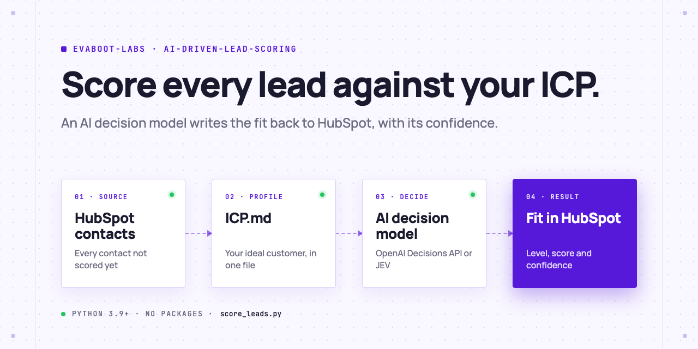
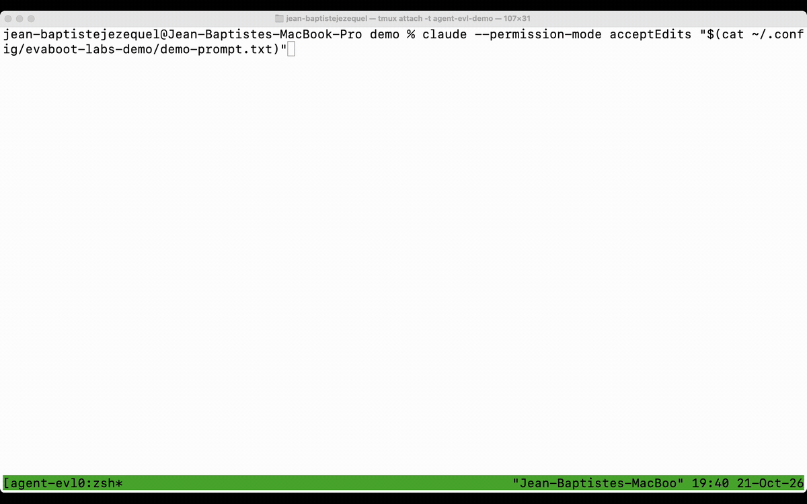
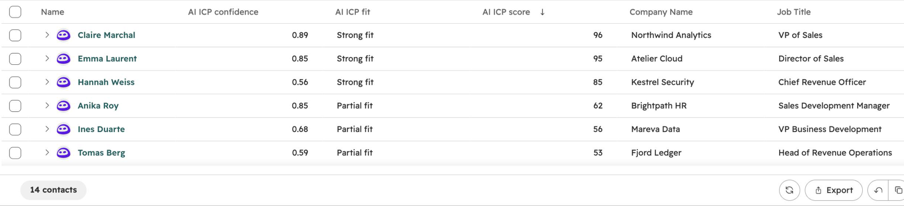
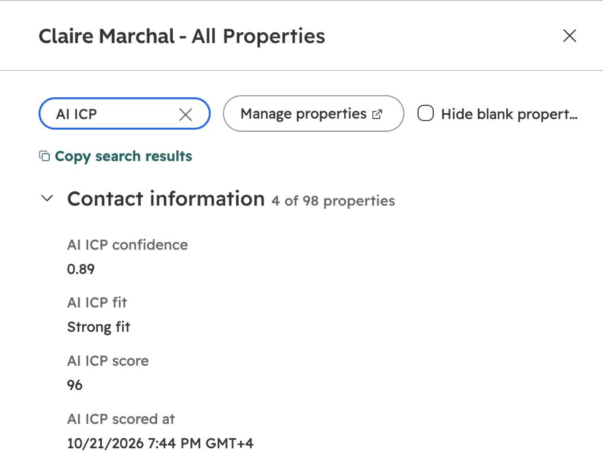
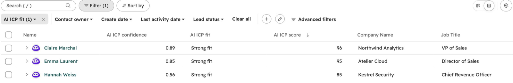
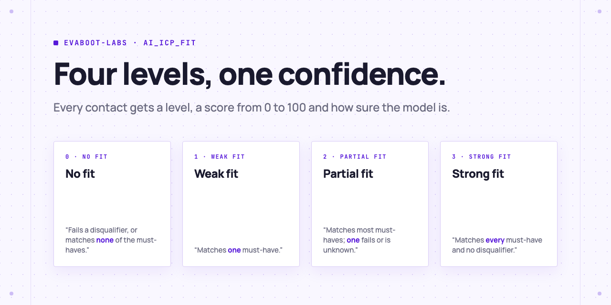

<picture>
  <source media="(prefers-color-scheme: dark)" srcset=".github/assets/banner-dark.png">
  
</picture>

# AI lead scoring: ICP fit in HubSpot

Score every HubSpot contact against your ideal customer profile with an AI decision model, and write the fit, a score from 0 to 100 and the model's confidence back to HubSpot.

[](AGENTS.md)
[](LICENSE)

[](.github/assets/demo.mp4)

<sub>The full run, at real speed: [demo.mp4](.github/assets/demo.mp4)</sub>

## Set it up in one prompt

Paste this into Claude Code, Codex or Cursor:

```text
Score my HubSpot contacts against my ideal customer profile. Clone
https://github.com/evaboot-labs/ai-driven-lead-scoring, read AGENTS.md and follow the
score-leads skill. Run a dry run first and show me the scores before you write anything
to HubSpot.
```

<details>
<summary>Or install the skill</summary>

Claude Code:

```text
/plugin marketplace add evaboot-labs/ai-driven-lead-scoring
/plugin install ai-driven-lead-scoring@evaboot-labs-ai-driven-lead-scoring
```

Codex, Cursor and other agents:

```bash
npx skills add evaboot-labs/ai-driven-lead-scoring
```

</details>

## How it works

**1. Every contact gets a fit.** The script scores each contact that has no score yet.



**2. Score and confidence on the record.** The confidence shows which leads need a human look.



**3. Filter on Strong fit and call those first.** Change `ICP.md`, rerun with `--rescore`, and every score follows.



## Four levels, one confidence

<picture>
  <source media="(prefers-color-scheme: dark)" srcset=".github/assets/levels-dark.png">
  
</picture>

A decision model returns a fixed answer with a probability, not free text: faster, cheaper and more consistent than a chat model for a score. The script writes `ai_icp_fit`, `ai_icp_score`, `ai_icp_confidence` and `ai_icp_scored_at`.

## What you need

- **HubSpot** (the free plan works) and a service key with five contact and company scopes: [setup](docs/setup.md).
- **An OpenAI API key**, or a Typesafe JEV key for `--model jev`.
- **Python 3.9 or later.** No packages to install.
- **Your ideal customer profile** in [`ICP.md`](ICP.md).
- **Cost:** about 8 cents of OpenAI per 1,000 contacts. Leads from an [Evaboot](https://dash.evaboot.com/accounts/signup/?last_click_origin=ai-driven-lead-scoring-repo) export come with the industry and size the score needs.

## Go further

| Page | For |
|---|---|
| [Set up and run](docs/setup.md) | Keys, options, JEV, and which HubSpot fields the model sees |
| [n8n workflow](docs/n8n.md) | The same scoring every morning in n8n |

---

Agents: start at [AGENTS.md](AGENTS.md) · Built by [Evaboot](https://evaboot.com) · More workflows at [github.com/evaboot-labs](https://github.com/evaboot-labs) · [MIT license](LICENSE)
